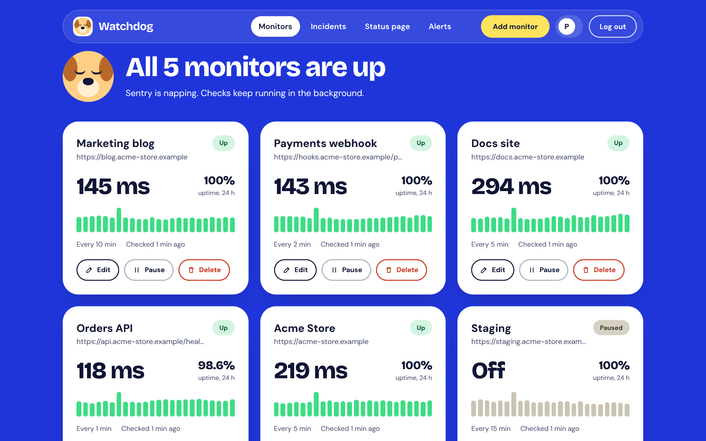
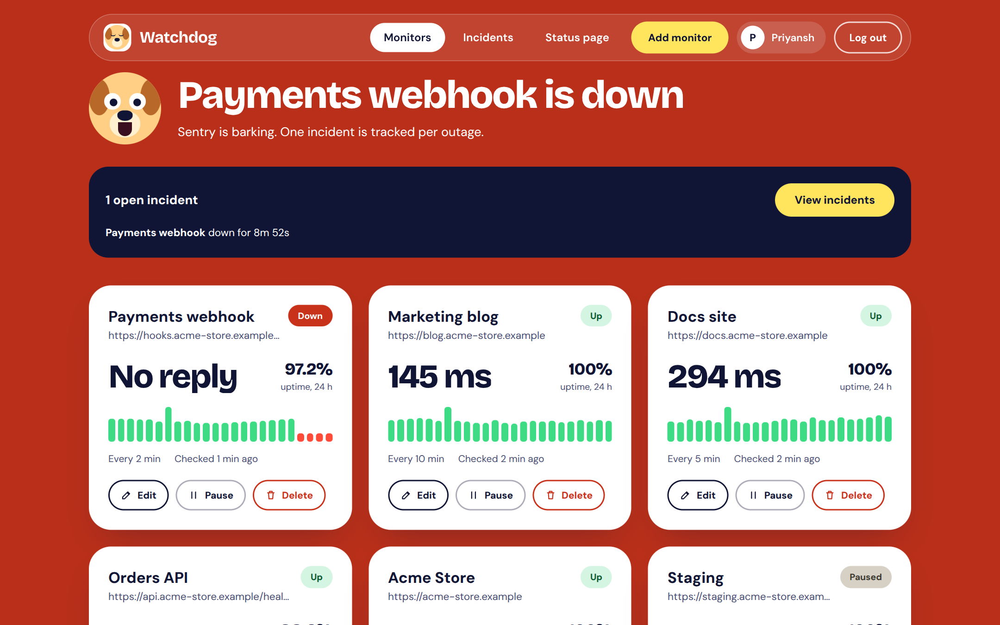
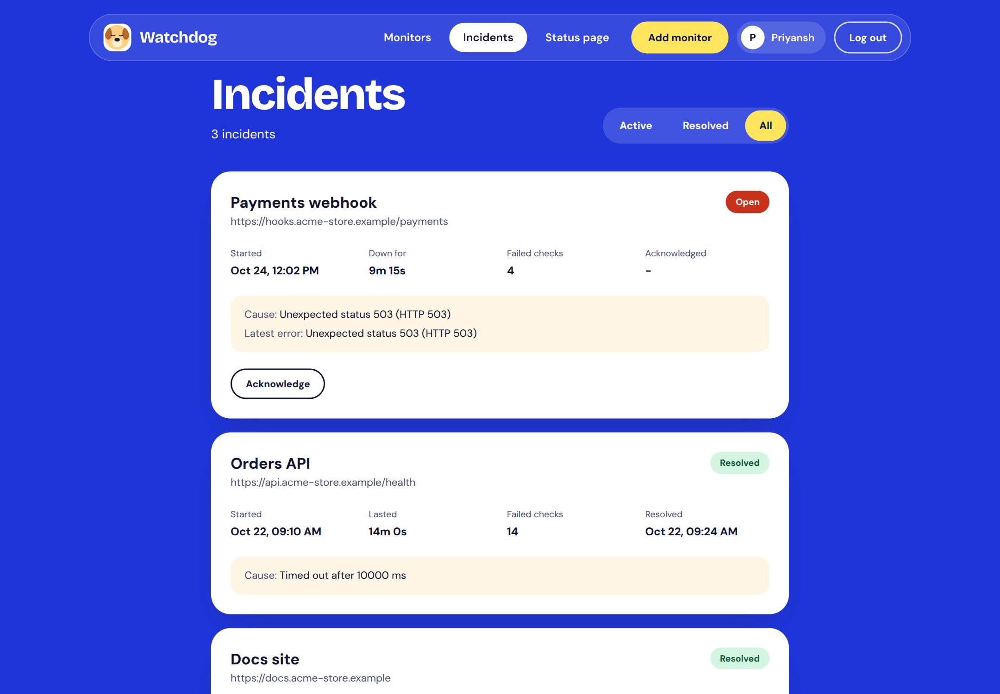
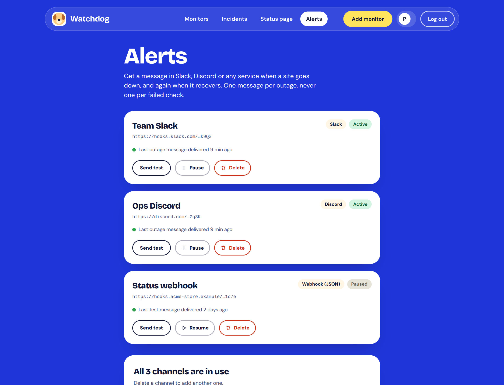
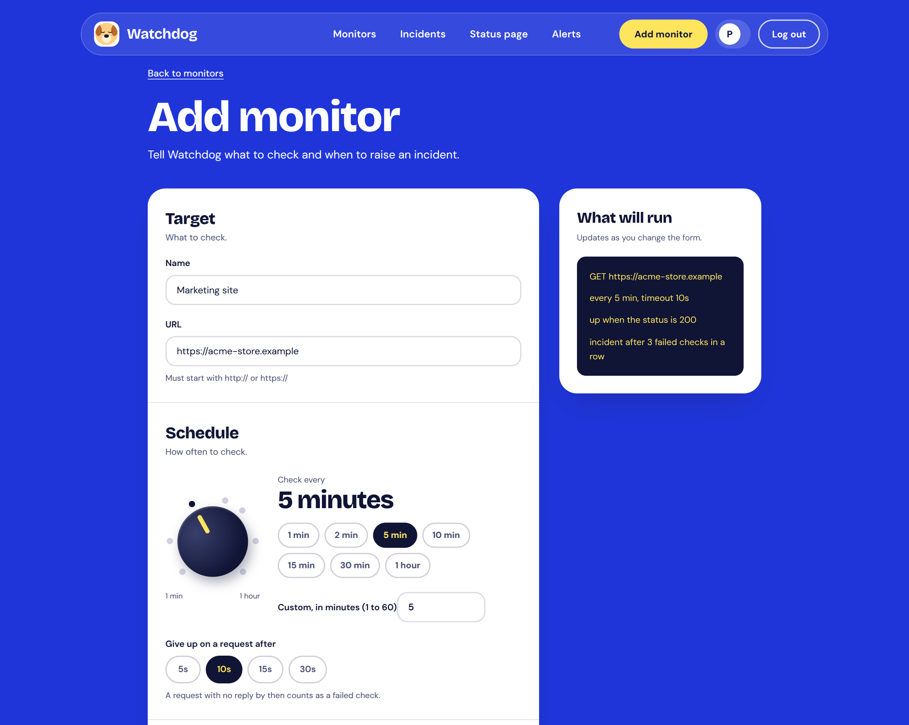
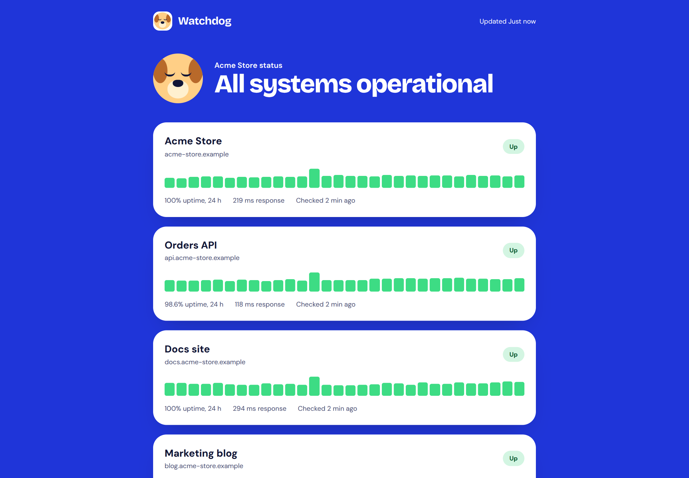
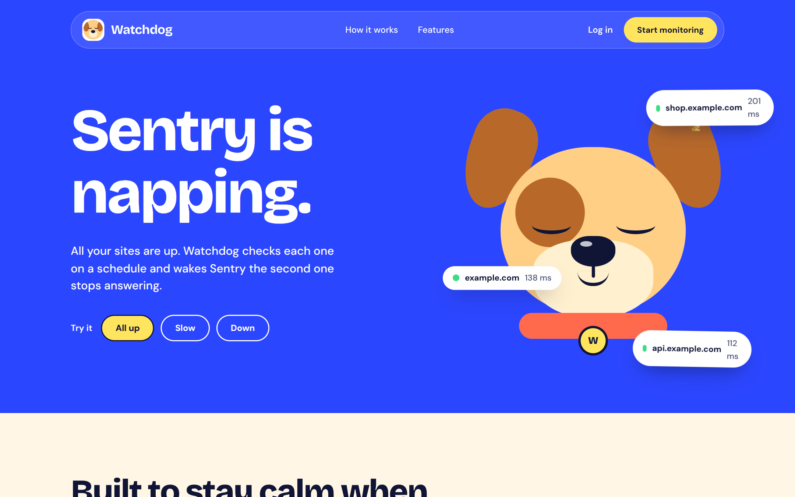
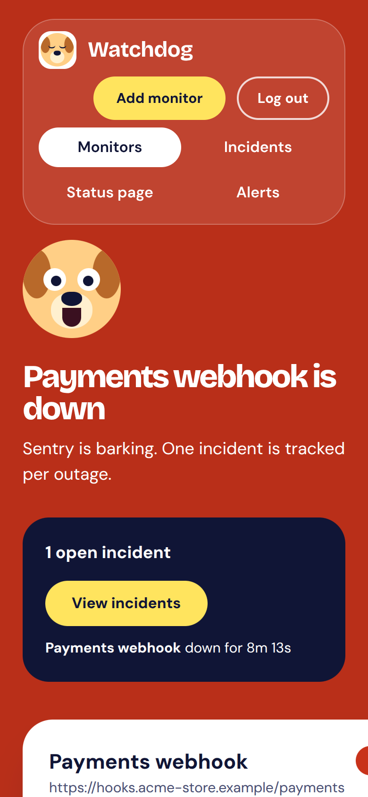

<div align="center">

# Watchdog

**Uptime and incident tracker for websites and APIs.**

Checks your sites on a schedule, calls one down only after repeated failures,<br>
opens a single incident per outage and closes it automatically on recovery.

[](https://github.com/Priyansh10ff/Watchdog/actions/workflows/ci.yml)
&nbsp;
&nbsp;
&nbsp;
&nbsp;

[Product](docs/PRODUCT.md)&nbsp; · &nbsp;[Requirements](docs/PRD.md)&nbsp; ·
&nbsp;[Technical](docs/TECHNICAL.md)&nbsp; · &nbsp;[Design](docs/DESIGN.md)&nbsp; ·
&nbsp;[API](docs/api.md)&nbsp; · &nbsp;[Deployment](docs/deployment.md)&nbsp; ·
&nbsp;[Testing](docs/TESTING.md)

<br>



</div>

---

## Why

Most people who run a website find out it is down when a user tells them.

The obvious fix is an uptime monitor, but the simple ones have three problems. They
raise an alarm on a single dropped request. They keep alerting through a long outage.
And they treat anything that is not a 200 as down, even though a login-protected API
answering 401 is perfectly alive.

So the hard part is not checking whether a site responds. It is deciding when a site
is really down. Watchdog judges every check against rules you set per monitor, and
only declares an outage after repeated failures.

## What it does

**Checks.** A scheduler runs every minute and claims each due monitor with an atomic
lease, so a restart or a second instance never checks the same monitor twice. Each
check follows up to 3 redirects, measures the response time, and judges the answer
against the monitor's expected status codes and optional keyword. Failures say why:
`Timed out after 5000 ms`, not `ECONNABORTED`.

**Decides.** A status machine counts consecutive failures. A monitor goes down when
the count reaches its threshold, and one success resets it. After a failure it is
re-checked within a minute, so outages are confirmed and recoveries noticed quickly.

**Responds.** One incident opens per outage, with the cause and start time. It is
updated while it lasts, can be acknowledged, and resolves itself with the total
duration when the site recovers.

**Tells you.** A webhook message to Slack, Discord or any service when an incident
opens and when it resolves. One per outage, never one per failed check.

**Shows and shares.** A dashboard with response time, 24-hour uptime and recent
checks, an incidents page with filters, and a public status page you can share
without a login. The status page never reveals your URLs.

**Protects itself.** In production the checker refuses private, loopback and
link-local addresses at DNS lookup, for IP literals and for redirect targets.

Each monitor has its own interval (1 to 60 minutes), timeout, expected status codes,
optional keyword and failure threshold. Up to 20 monitors and 3 alert channels per
account.

## Screenshots

<div align="center">

**The dashboard when a site goes down**<br>


<br>

**Incidents** — cause, start time, failed checks, acknowledgement and duration<br>


<br>

**Alerts** — webhook channels for Slack, Discord or any service<br>


<br>

**Add a monitor** — interval dial, status codes and failure threshold<br>


<br>

**Public status page** — shareable, no login, no URLs<br>


<br>

<table>
<tr>
<td align="center" width="50%"><b>Landing page</b></td>
<td align="center" width="50%"><b>On a phone</b></td>
</tr>
<tr>
<td align="center" valign="top"></td>
<td align="center" valign="top"></td>
</tr>
</table>

</div>

> The screenshots show sample data.

## Quickstart

Requires **Node.js 20+** and a MongoDB database (a free Atlas cluster works).

```bash
git clone https://github.com/Priyansh10ff/Watchdog.git
cd Watchdog
```

### 1. API

```bash
cd server
npm install
cp .env.example .env          # Windows: copy .env.example .env
```

Fill in `MONGO_URI` and `JWT_SECRET` in `server/.env` (see
[Configuration](#configuration)), then:

```bash
npm run dev
```

It starts on `http://localhost:5000` and logs `DB Connected`, `Server started on
port 5000` and `Scheduler started`.

### 2. Client

```bash
cd client
npm install
cp .env.example .env
npm run dev
```

The app runs on `http://localhost:5173`. If your network blocks MongoDB SRV
lookups, use the non-SRV connection string from Atlas.

### 3. Demo target (optional)

A small site you can switch up, slow or down on demand:

```bash
cd demo-target
npm install
npm start
```

Open `http://localhost:4000`, add a monitor for `http://localhost:4000/health`, then
use the links on that page to break it and watch Watchdog react.

## Configuration

Server (`server/.env`):

| Variable | Required | Default | Description |
|---|---|---|---|
| `MONGO_URI` | yes | | MongoDB connection string |
| `JWT_SECRET` | yes | | Secret for session tokens. Use a long random value |
| `JWT_EXPIRES_IN` | no | `7d` | Session length |
| `PORT` | no | `5000` | API port |
| `NODE_ENV` | no | | `production` enables secure cookies, trust proxy and private-address blocking |
| `CLIENT_URL` | no | `http://localhost:5173` | Allowed browser origin, no trailing slash |
| `DISABLE_SCHEDULER` | no | `false` | `true` runs the API without the scheduler |
| `SEED_SHOWCASE` | no | `true` in production, `false` otherwise | `true` makes the API create the landing page ticker's status page and its 12 monitors on start, if the page does not exist yet |
| `API_RATE_LIMIT` | no | `600` | Requests per IP every 15 minutes across the API, except the health check |
| `COOKIE_SAMESITE` | no | `none` in production, `lax` otherwise | `SameSite` of the session cookie. Use `lax` behind the Vercel proxy |
| `TRUST_PROXY` | no | `1` | Proxy hops in front of the API in production, for rate limiting. Use `2` behind the Vercel proxy option |

Client (`client/.env`):

| Variable | Default | Description |
|---|---|---|
| `VITE_API_URL` | `http://localhost:5000/api` | API base URL. Use `/api` when the client host proxies the API |
| `VITE_SHOWCASE_SLUG` | `world` | Link name of the status page used for the landing page ticker |
| `VITE_FAVICON_URL` | Google's favicon service | First icon service the ticker tries, with `{domain}` where the host name goes |

Generate a secret with `node -e
"console.log(require('crypto').randomBytes(32).toString('hex'))"`. Never commit real
secrets. `.env` files are ignored by Git.

## Using it

**Website.** `/` is the landing page. After signing up: `/dashboard` for the monitors,
`/monitors/new` and `/monitors/:id/edit` to add and change them, `/incidents` for
incidents and `/status-page` to publish a public page at `/status/:slug`.

**API.** All routes are under `/api` and everything except health, register and login
needs the session cookie. Log in, then create and list monitors:

```bash
curl -c cookies.txt -H "Content-Type: application/json" \
     -d '{"email":"you@example.com","password":"your-password"}' \
     http://localhost:5000/api/auth/login

curl -b cookies.txt -H "Content-Type: application/json" \
     -d '{"name":"My site","url":"https://example.com","intervalMinutes":5}' \
     http://localhost:5000/api/monitors

curl -b cookies.txt http://localhost:5000/api/monitors
```

On Windows PowerShell `curl` is a different command, so use Git Bash or the Postman
collection in [docs/postman](docs/postman). The full endpoint list, bodies, filters and
error codes are in [docs/api.md](docs/api.md).

| Group | Endpoints |
|---|---|
| Auth | `POST /auth/register`, `POST /auth/login`, `GET /auth/me`, `POST /auth/logout` |
| Monitors | `POST /monitors`, `GET /monitors`, `GET`, `PATCH`, `DELETE /monitors/:id`, `PATCH /monitors/:id/toggle`, `GET /monitors/:id/results`, `POST /monitors/:id/check`, `GET /monitors/:id/incidents` |
| Incidents | `GET /incidents`, `GET /incidents/:id`, `PATCH /incidents/:id/acknowledge` |
| Status page | `GET /status/:slug` (public), `GET`, `PUT`, `DELETE /status-page` |
| Alerts | `GET /webhooks`, `POST /webhooks`, `PATCH`, `DELETE /webhooks/:id`, `POST /webhooks/:id/test` |
| Health | `GET /health` |

**Alerts.** Add a webhook channel on `/alerts` and Watchdog posts a message when a monitor
goes down and when it recovers. Slack and Discord webhook URLs work as they are; `generic`
sends JSON signed with an HMAC so your own service can verify it. Up to 3 channels per
account, and a Send test button checks a channel straight away. The message format and the
signature are described in [docs/api.md](docs/api.md).

**Landing page ticker.** The ticker on the landing page shows real checks of 12 popular
sites from a public status page called `world`. In production the API creates it by itself
the first time it starts, so there is nothing to run after deploying (set
`SEED_SHOWCASE=false` to stop that). On your own computer, create it with one command and
keep the API running so its scheduler runs the first checks:

```bash
cd server
node scripts/seedShowcase.js
```

Without that page the section is hidden. If the API is still starting when someone opens
the landing page, the ticker retries every few seconds and appears by itself. Production
setup and options are in [docs/deployment.md](docs/deployment.md).

## Architecture

```
Browser (React)  --- JWT cookie --->  Express API  --->  MongoDB
                                         |
                                  node-cron, every minute
                                         |  claims due monitors (atomic lease)
                                         v
                              checker.service  ->  CheckResult
                                         v
                              incident.service ->  status machine + Incident
```

| Layer | Choice |
|---|---|
| Frontend | React 19, Vite, React Router, Tailwind CSS v4, Axios, GSAP |
| Backend | Node.js, Express 5, node-cron, Axios |
| Database | MongoDB with Mongoose |
| Auth | JWT in an httpOnly cookie, bcrypt |
| Hardening | helmet, express-rate-limit, CORS with credentials |
| Testing and CI | Node's built-in test runner, GitHub Actions |
| Hosting | Vercel (client), Render (API), MongoDB Atlas (database) |

The API and the scheduler run in one process. Details in
[docs/TECHNICAL.md](docs/TECHNICAL.md).

## Project layout

```
client/        React app (pages, components, context, services)
server/        Express API (controllers, models, routes, services, jobs, utils, tests)
demo-target/   Small site you can switch up, slow or down for demos
docs/          Product, requirements, technical, design, API, deployment and test docs, Postman collection
.github/       CI workflow: tests and client build on every push
render.yaml    Render blueprint for the API and the demo target
```

## Tests

```bash
cd server && npm test
cd client && npm test
```

596 server tests and 88 client tests, using Node's built-in test runner, so there is
nothing extra to install. The server tests need no database or internet: they replace the
models with in-memory stand-ins and test the check engine against a real local web server.
GitHub Actions runs both suites and the client build on every push. `docs/TESTING.md`
lists what is covered and holds the manual cases for the interface.

To check a deployed app end to end, run the smoke test. It registers a throwaway account
and goes through the main features over the real address. With `--demo` it also breaks the
demo site and confirms that exactly one incident opens, can be acknowledged and resolves
with its duration:

```bash
cd server
npm run smoke -- https://your-app.vercel.app --demo=https://your-demo-target.onrender.com
```

## Deployment

Watchdog runs on MongoDB Atlas (database), Render (API) and Vercel (client). Step-by-step
instructions, the production settings and a troubleshooting table are in
[docs/deployment.md](docs/deployment.md). Three things matter in production:

- The scheduler runs inside the API process, so the API instance must stay awake. On a
  free plan, point an external pinger at `/api/health` every 5 minutes.
- `NODE_ENV=production` turns on secure cookies, trust proxy and private-address blocking,
  and `CLIENT_URL` must match the client origin exactly.
- When the client and API are on different domains, proxy `/api` through the client host
  so the session cookie stays first-party.

## Security

- Passwords are hashed with bcrypt and never returned by the API.
- The session is an httpOnly cookie. In production it is `secure`, and `SameSite` is
  `none` by default or `lax` when the client proxies the API (`COOKIE_SAMESITE=lax`),
  which also blocks cross-site request forgery.
- Request types are validated, which blocks NoSQL injection. Every monitor and incident
  query is scoped to the logged-in user.
- Rate limits per IP: 600 requests per 15 minutes across the API, 10 per 15 minutes on
  register and login, and 60 per minute on the public status page. 20 monitors per user.
- helmet headers, CORS restricted to `CLIENT_URL`, 10 kB body limit.
- In production the checker blocks private, loopback and link-local addresses at DNS
  lookup time, for IP-literal URLs and for redirect targets.
- Webhook addresses are never returned by the API, never logged, and shown only as a
  masked preview. Outgoing alerts use the same private-address blocking as the checker and
  never follow redirects.
- Secrets live only in environment variables.

## Limitations and roadmap

- One scheduler process. Atomic claiming already makes extra instances safe.
- HTTP and HTTPS only, GET and HEAD only.
- Alerts go to webhooks (Slack, Discord or any service). No email or SMS, because free
  hosting blocks outgoing mail.

Next: SSL certificate expiry warnings, a response-time chart, encrypted custom headers for
authenticated checks, maintenance windows and a second-region checker. The full plan is in
[docs/PRD.md](docs/PRD.md).

## Documentation

| Document | Covers |
|---|---|
| [PRODUCT.md](docs/PRODUCT.md) | What Watchdog is, why it exists, who it is for |
| [PRD.md](docs/PRD.md) | Requirements, user stories, acceptance criteria, release plan, risks |
| [TECHNICAL.md](docs/TECHNICAL.md) | Architecture, check pipeline, status machine, security, configuration |
| [DESIGN.md](docs/DESIGN.md) | Design system: colour, type, components, motion and accessibility |
| [api.md](docs/api.md) | API reference |
| [database-schema.md](docs/database-schema.md) | Collections and indexes |
| [deployment.md](docs/deployment.md) | Hosting guide and troubleshooting |
| [TESTING.md](docs/TESTING.md) | Automated tests and manual test cases with expected results |
| [DEMO.md](docs/DEMO.md) | Demo video script and submission form text |
| [postman](docs/postman) | Postman collection and environments |
| [CHECKLIST.md](docs/CHECKLIST.md) | Submission and production readiness checklist |

## License

MIT. See [LICENSE](LICENSE).

## Author

Built by [Priyansh Dugar](https://github.com/Priyansh10ff) as an end-term project for
Web Development at Scaler School of Technology, Bengaluru.

<div align="center">
<br>

<sub>Built with MongoDB, Express, React and Node · 684 automated tests · MIT licensed</sub>

</div>
